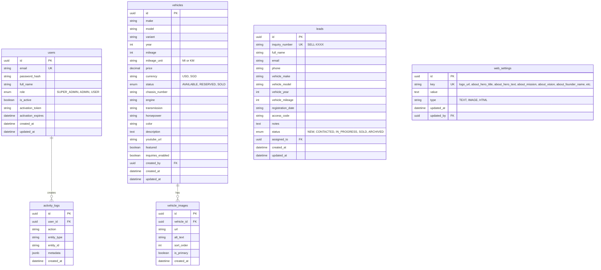
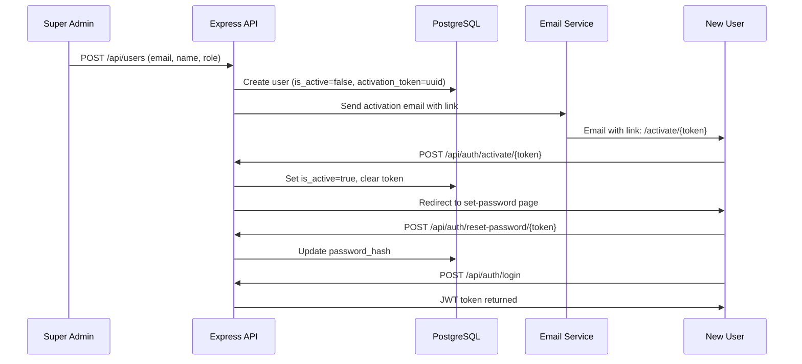

# Forest Wheel — Backend & Admin Portal Implementation Plan

Backend system to power the Forest Wheel admin portal and public-facing website, using **PostgreSQL** as the database with a Node.js/Express API server.

## Recommended Backend Stack

| Layer | Technology | Why |
|-------|-----------|-----|
| **Runtime** | Node.js 20 LTS | Same language as frontend (JS/TS), large ecosystem, easy to maintain |
| **API Framework** | Express.js | Minimalist, battle-tested, massive community, easy to learn |
| **ORM** | Prisma | Type-safe, auto-generated client, excellent migration system, first-class PostgreSQL support |
| **Database** | PostgreSQL 16 | Your choice — robust, relational, production-grade |
| **Authentication** | JWT (jsonwebtoken) + bcrypt | Stateless auth with secure password hashing |
| **Email** | Nodemailer + SMTP | Simple email sending for activation links (works with Gmail, SendGrid, Mailgun, etc.) |
| **File Upload** | Multer + local disk (or S3-compatible) | Image uploads for inventory and logo |
| **Validation** | Zod | Runtime schema validation for all API inputs |
| **CORS** | cors middleware | Allow admin & public frontends to communicate with API |

> [!TIP]
> This stack is intentionally simple — no overcomplicated frameworks. A solo developer or small team can maintain it easily. The entire backend is JavaScript, matching your existing React frontend.

---

## Monorepo Structure (After Implementation)

```
forestwheel-web-ai/
├── apps/
│   ├── web/                  ← Existing public-facing Vite React app
│   │   └── src/
│   │       ├── pages/        (Home, Inventory, SellCar, AboutUs)
│   │       └── components/
│   ├── admin/                ← [NEW] Admin portal Vite React app
│   │   ├── package.json
│   │   ├── vite.config.js
│   │   └── src/
│   │       ├── main.jsx
│   │       ├── App.jsx
│   │       ├── index.css
│   │       ├── contexts/
│   │       │   └── AuthContext.jsx
│   │       ├── components/
│   │       │   ├── AdminLayout.jsx      (sidebar + topbar shell)
│   │       │   ├── ProtectedRoute.jsx
│   │       │   └── ...
│   │       └── pages/
│   │           ├── Login.jsx
│   │           ├── Dashboard.jsx
│   │           ├── InventoryList.jsx
│   │           ├── InventoryForm.jsx
│   │           ├── LeadsList.jsx
│   │           ├── LeadDetail.jsx
│   │           ├── UserManagement.jsx
│   │           ├── AdminManagement.jsx
│   │           └── WebSettings.jsx
│   └── api/                  ← [NEW] Express.js backend API
│       ├── package.json
│       ├── prisma/
│       │   ├── schema.prisma
│       │   └── seed.js
│       └── src/
│           ├── index.js          (server entry)
│           ├── config/
│           │   └── env.js        (environment config)
│           ├── middleware/
│           │   ├── auth.js       (JWT verification)
│           │   ├── upload.js     (Multer config)
│           │   └── validate.js   (Zod validation)
│           ├── routes/
│           │   ├── auth.js
│           │   ├── users.js
│           │   ├── inventory.js
│           │   ├── leads.js
│           │   ├── settings.js
│           │   └── dashboard.js
│           ├── services/
│           │   ├── authService.js
│           │   ├── emailService.js
│           │   ├── userService.js
│           │   ├── inventoryService.js
│           │   ├── leadService.js
│           │   ├── settingsService.js
│           │   └── dashboardService.js
│           └── utils/
│               ├── jwt.js
│               └── pagination.js
├── package.json              (monorepo root, updated workspaces)
└── .env                      (shared environment variables)
```

---

## Database Schema (PostgreSQL via Prisma)

### Entity Relationship



### Tables Summary

| Table | Purpose |
|-------|---------|
| `users` | Admin/user accounts with role-based access |
| `vehicles` | Car inventory listings |
| `vehicle_images` | Multiple images per vehicle |
| `leads` | "Sell Your Car" form submissions |
| `web_settings` | KV store for logo, about-us content, etc. |
| `activity_logs` | Audit trail for admin actions |

---

## API Endpoints

### Authentication (`/api/auth`)

| Method | Endpoint | Description |
|--------|----------|-------------|
| `POST` | `/login` | Admin login → returns JWT |
| `POST` | `/activate/:token` | Activate user account via email link |
| `POST` | `/forgot-password` | Send password reset email |
| `POST` | `/reset-password/:token` | Reset password with token |
| `GET`  | `/me` | Get current user profile |

### User Management (`/api/users`) — Admin only

| Method | Endpoint | Description |
|--------|----------|-------------|
| `GET` | `/` | List all users (paginated) |
| `POST` | `/` | Create new user → sends activation email |
| `GET` | `/:id` | Get user details |
| `PUT` | `/:id` | Update user (name, role, active status) |
| `DELETE` | `/:id` | Soft-delete / deactivate user |
| `POST` | `/:id/resend-activation` | Resend activation email |

### Inventory (`/api/inventory`)

| Method | Endpoint | Description |
|--------|----------|-------------|
| `GET` | `/` | List vehicles (paginated, filterable) — **also used by public site** |
| `GET` | `/:id` | Get vehicle detail |
| `POST` | `/` | Create new listing (with image upload) |
| `PUT` | `/:id` | Update listing |
| `DELETE` | `/:id` | Delete listing |
| `POST` | `/:id/images` | Upload additional images |
| `DELETE` | `/:id/images/:imageId` | Remove an image |

### Leads (`/api/leads`)

| Method | Endpoint | Description |
|--------|----------|-------------|
| `GET` | `/` | List all leads (paginated, filterable by status) |
| `GET` | `/:id` | Get lead detail |
| `POST` | `/` | Submit "Sell Your Car" form — **public endpoint** |
| `PUT` | `/:id` | Update lead status, notes, assignment |
| `DELETE` | `/:id` | Archive/delete lead |
| `GET` | `/export` | Export leads as CSV |

### Web Settings (`/api/settings`)

| Method | Endpoint | Description |
|--------|----------|-------------|
| `GET` | `/` | Get all settings — **also used by public site** |
| `GET` | `/:key` | Get single setting |
| `PUT` | `/:key` | Update setting value |
| `POST` | `/logo` | Upload new logo image |

### Dashboard (`/api/dashboard`)

| Method | Endpoint | Description |
|--------|----------|-------------|
| `GET` | `/stats` | Aggregated stats (total inventory, available, sold, leads) |
| `GET` | `/activity` | Recent activity feed |
| `GET` | `/revenue` | Monthly revenue/velocity data |

---

## Admin Portal Pages (React)

### Page → Backend Mapping

| Admin Page | Description | API Endpoints Used |
|------------|-------------|-------------------|
| **Login** | JWT authentication with email/password | `POST /api/auth/login` |
| **Dashboard** | Stats cards, activity feed, revenue widget | `GET /api/dashboard/*` |
| **Inventory List** | Table view of all vehicles with search/filter | `GET /api/inventory` |
| **Inventory Form** | Add/edit vehicle with image uploads | `POST/PUT /api/inventory` |
| **Leads List** | All "Sell Your Car" submissions with status filters | `GET /api/leads` |
| **Lead Detail** | View/update lead, change status, add notes | `GET/PUT /api/leads/:id` |
| **User Management** | CRUD users, send activation emails | `GET/POST/PUT /api/users` |
| **Admin Management** | Manage admin accounts (SUPER_ADMIN only) | Same as users, filtered by role |
| **Web Settings** | Change logo, edit about-us content | `GET/PUT /api/settings`, `POST /api/settings/logo` |

### User Activation Flow



---

## User Review Required

> [!IMPORTANT]
> **Database hosting**: Where will PostgreSQL be hosted? Options:
> - Local development: Docker container or native install
> - Production: Supabase (free tier), Railway, Neon, or a VPS with PostgreSQL installed
> 
> Please confirm your preference so I can configure the connection accordingly.

> [!IMPORTANT]
> **Email provider**: For user activation emails, which SMTP service do you prefer?
> - Gmail App Password (simplest for development)
> - SendGrid (free tier: 100 emails/day)
> - Mailgun, Amazon SES, or other
> 
> This affects the Nodemailer transport configuration.

> [!IMPORTANT]
> **File storage**: Where should uploaded images (vehicle photos, logo) be stored?
> - **Local disk** (simplest for development, served by Express static)
> - **Cloudinary** (free tier: 25GB, automatic image optimization)
> - **AWS S3 / DigitalOcean Spaces**
> 
> For development, I'll default to local disk with easy swap to cloud later.

> [!WARNING]
> **Admin vs User Management clarification**: From your request, you mentioned both "User Maintenance" and "Admin Maintenance." I'm interpreting this as:
> - **User Management**: CRUD for all user accounts (any role)
> - **Admin Management**: Same page but filtered to only show ADMIN and SUPER_ADMIN roles, accessible only by SUPER_ADMIN
> 
> Is this correct, or do "Users" represent a separate customer-facing account system?

---

## Proposed Changes

### Root Monorepo Config

#### [MODIFY] [package.json](file:///e:/AI/forestwheel-web-ai/package.json)
- Add `apps/api` and `apps/admin` to workspaces

#### [NEW] `.env`
- Database URL, JWT secret, SMTP config, upload directory

---

### API Server (`apps/api`)

#### [NEW] `apps/api/package.json`
- Express, Prisma, jsonwebtoken, bcrypt, multer, nodemailer, zod, cors, dotenv

#### [NEW] `apps/api/prisma/schema.prisma`
- Full database schema: users, vehicles, vehicle_images, leads, web_settings, activity_logs

#### [NEW] `apps/api/prisma/seed.js`
- Seeds default super admin, initial web_settings values (logo, about-us content)

#### [NEW] `apps/api/src/index.js`
- Express server entry with middleware setup, route mounting, error handling

#### [NEW] `apps/api/src/config/env.js`
- Centralized environment variable access

#### [NEW] `apps/api/src/middleware/auth.js`
- JWT verification middleware, role-checking middleware

#### [NEW] `apps/api/src/middleware/upload.js`
- Multer configuration for image uploads

#### [NEW] `apps/api/src/middleware/validate.js`
- Zod schema validation middleware

#### [NEW] `apps/api/src/routes/auth.js`
- Login, activation, password reset routes

#### [NEW] `apps/api/src/routes/users.js`
- CRUD user management routes

#### [NEW] `apps/api/src/routes/inventory.js`
- Vehicle CRUD + image management routes

#### [NEW] `apps/api/src/routes/leads.js`
- Lead CRUD + CSV export routes

#### [NEW] `apps/api/src/routes/settings.js`
- Web settings GET/PUT + logo upload

#### [NEW] `apps/api/src/routes/dashboard.js`
- Stats, activity, revenue aggregation routes

#### [NEW] `apps/api/src/services/*.js`
- Business logic layer for each domain (auth, email, users, inventory, leads, settings, dashboard)

#### [NEW] `apps/api/src/utils/jwt.js`
- JWT sign/verify helpers

#### [NEW] `apps/api/src/utils/pagination.js`
- Pagination helper for list endpoints

---

### Admin Portal (`apps/admin`)

#### [NEW] `apps/admin/package.json`
- React 18, react-router-dom, Tailwind CSS, axios

#### [NEW] `apps/admin/vite.config.js`
- Vite config with proxy to API server

#### [NEW] `apps/admin/tailwind.config.js`
- Same Forest Wheel design tokens as Stitch pages

#### [NEW] `apps/admin/src/main.jsx`
- App entry, AuthProvider wrapper

#### [NEW] `apps/admin/src/App.jsx`
- Route definitions with ProtectedRoute wrapper

#### [NEW] `apps/admin/src/contexts/AuthContext.jsx`
- JWT storage, login/logout, user state management

#### [NEW] `apps/admin/src/components/AdminLayout.jsx`
- Sidebar + top bar shell (matching Stitch designs)

#### [NEW] `apps/admin/src/components/ProtectedRoute.jsx`
- Redirect to login if not authenticated

#### [NEW] `apps/admin/src/pages/Login.jsx`
- Admin login page (matching Stitch login design)

#### [NEW] `apps/admin/src/pages/Dashboard.jsx`
- Stats cards, activity feed, revenue widget (matching Stitch dashboard design)

#### [NEW] `apps/admin/src/pages/InventoryList.jsx`
- Table view of vehicles (matching Stitch inventory table design)

#### [NEW] `apps/admin/src/pages/InventoryForm.jsx`
- Add/edit vehicle form with image uploads (matching Stitch edit listing design)

#### [NEW] `apps/admin/src/pages/LeadsList.jsx`
- Lead pipeline view (matching Stitch leads design)

#### [NEW] `apps/admin/src/pages/LeadDetail.jsx`
- Individual lead detail with status update and notes

#### [NEW] `apps/admin/src/pages/UserManagement.jsx`
- User list with create/edit/deactivate actions

#### [NEW] `apps/admin/src/pages/AdminManagement.jsx`
- Admin-only user list (SUPER_ADMIN access only)

#### [NEW] `apps/admin/src/pages/WebSettings.jsx`
- Logo upload, about-us content editor

---

### Public Frontend Modifications (`apps/web`)

#### [MODIFY] `apps/web/src/pages/SellCar.jsx`
- Connect form submission to `POST /api/leads`

#### [MODIFY] `apps/web/src/pages/Inventory.jsx`
- Fetch vehicle data from `GET /api/inventory`

#### [MODIFY] `apps/web/src/pages/AboutUs.jsx`
- Fetch dynamic content from `GET /api/settings`

#### [MODIFY] `apps/web/src/components/TopNavBar.jsx`
- Fetch logo from `GET /api/settings/logo_url`

#### [MODIFY] `apps/web/src/components/FeaturedShowroom.jsx`
- Fetch featured vehicles from `GET /api/inventory?featured=true`

---

## Open Questions

> [!IMPORTANT]
> 1. **Database hosting preference?** (Docker local / Supabase / Railway / VPS)
> 2. **Email SMTP provider?** (Gmail / SendGrid / other)
> 3. **Image storage?** (Local disk / Cloudinary / S3)
> 4. **Is "User Management" for internal staff only, or also for public customers?**
> 5. **Should the admin portal be on a separate subdomain (e.g., `admin.forestwheel.com`) or a sub-path (`/admin`)?**
> 6. **Do you need role granularity beyond SUPER_ADMIN / ADMIN / USER?** (e.g., "Editor" who can only manage inventory but not users)

---

## Verification Plan

### Automated Tests
- API endpoints tested with `supertest` + `vitest`
- Database operations verified via Prisma test utilities
- Auth flow tested end-to-end (login → JWT → protected route)

### Manual Verification
- Run `npx prisma migrate dev` and verify schema in PostgreSQL
- Seed DB with `npx prisma db seed` → verify default admin can log in
- Test activation email flow with MailHog (local SMTP trap)
- Browser test: Login → Dashboard → Create listing → View on public site
- Browser test: Submit "Sell Your Car" form → appears in admin Leads page
- Browser test: Change logo/about-us → verify public site updates
